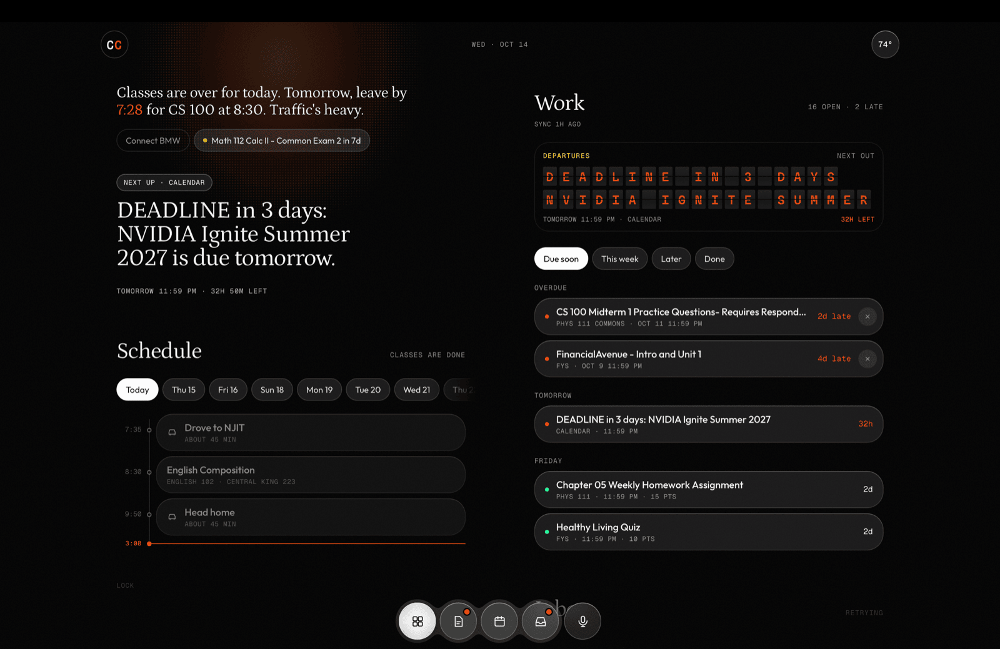
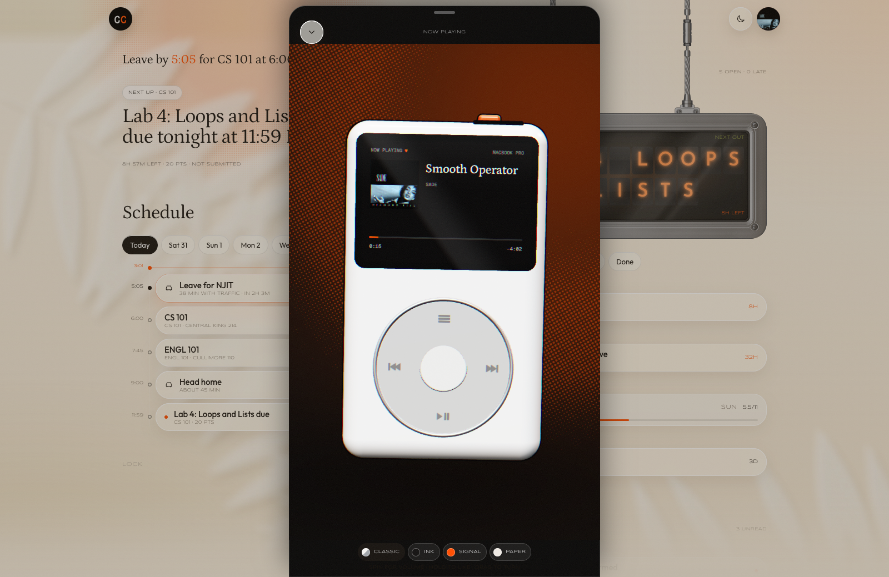
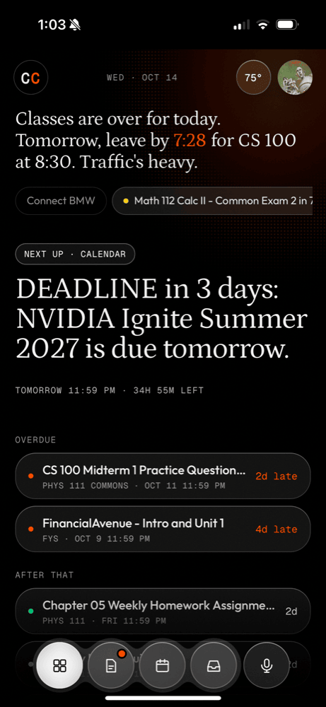
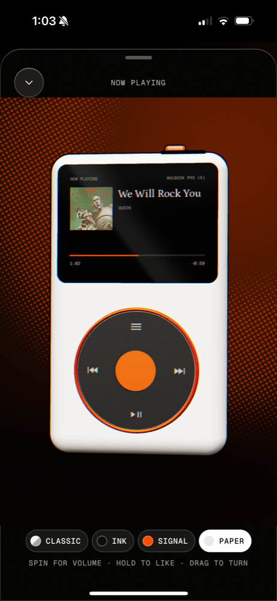

# Command Center

**🚧 In development.** It runs every day on my phone and Mac, and I keep adding to it. See the [roadmap](#roadmap).

Command Center is a personal dashboard web app that puts my Canvas deadlines, Google Calendar, Gmail, live commute times (Google Maps), and Spotify on one screen. It runs at $0/month on free tiers, with API quota caps so costs can't creep up. It is built for one person (me) and sits behind a PIN.



<p align="center">
  
  
  
</p>

## Why I built this

Between Canvas, my calendar, my email, and figuring out when I actually needed to leave for class, staying on top of college meant opening a handful of different apps every single day. I wanted one screen that pulls all of it together and keeps itself up to date: what's due, what's next, when to leave, and what's playing. It's built just for me, it runs for $0 a month, and I'm building it to keep growing as I add more to it.

## What's on the screen

- **Today:** one plain-language sentence ("Leave by 7:35 for English 102 at 8:30."), the next thing due, and what's after that. Chips for drive time, rain, and the next exam. A quote under it takes turns between a Bible verse and a line from a Substack post.
- **Work:** a split-flap departures board showing the next assignment out, then everything due, grouped by day, with progress pills for homework that reports a partial score.
- **Schedule:** a timeline rail with a "now" line, drives placed on the rail ("Leave for NJIT", "Head home"), and day chips for the next two weeks.
- **Inbox:** unread Gmail, important first.
- **Now playing:** a 3D click-wheel music player (three.js) wired to the real Spotify state: play, pause, skip, volume by spinning the wheel, long-press to like.
- **Talk:** a voice or text assistant that answers from the dashboard's own data and can save notes or dismiss items.

On the phone it is a swipe-page PWA added to the home screen. On the Mac it is two columns.

## Architecture

```
GitHub Actions (schedule) ► scripts/canvas_sync.py ──► POST /api/canvas/ingest ─┐
                                                      (x-ingest-secret header)  │
                                                                                ▼
Phone / Mac (PWA) ◄──── src/worker.js (Cloudflare Worker) ◄──── KV: snapshots, tokens, caps
                              │
                              ├── Canvas REST API        (cron every 30 min)
                              ├── Google Calendar + Gmail (OAuth 2.0, refresh token in KV)
                              ├── Google Routes API       (live drive time, daily + monthly caps)
                              ├── Spotify Web API         (OAuth 2.0; now playing + controls)
                              ├── Open-Meteo              (weather, no key)
                              └── Workers AI              (Talk answers, daily neuron budget)
```

- **Backend:** one Cloudflare Worker in JavaScript (`src/worker.js`). It handles PIN login (HMAC-signed cookie, lockout after 5 wrong tries), the Google and Spotify OAuth flows, every `/api/*` route, caching in Workers KV, and a 30-minute cron that refreshes Canvas.
- **Frontend:** a static PWA served by the same Worker (`public/`). The UI source of truth is `dashboard.source.html`; `build_frontend.py` (Python) assembles `public/index.html` from it by swapping in the standalone data layer. Fonts: Petrona, Outfit, Geist Mono.
- **Canvas sync (Python):** Canvas started blocking requests from Cloudflare's servers. I restored the direct fetch and added a Python fallback (`scripts/canvas_sync.py`) that runs on a schedule in GitHub Actions, pulls assignments through the Canvas REST API with pagination, and posts them to a secret-key-protected endpoint. Whichever data is fresher wins.

### Design decisions

- **$0 a month, enforced in code.** Every paid-tier risk has a counter in KV and a cap: Google Routes calls stop at `MAPS_DAILY_CAP` and `MAPS_MONTHLY_CAP` (then the app falls back to a fixed 45-minute drive), Talk stops at `AI_DAILY_NEURONS` on Workers AI (then messages are saved as notes), and the car check has daily and monthly caps. The caps are set below each service's free allowance.
- **Leave-by time is computed, not typed.** The Worker asks the Routes API for a traffic-aware drive, corrects once with the real duration, and caches the answer for 10 minutes to 3 hours depending on how far out the class is.
- **Secrets never touch the repo.** Every token lives in Cloudflare (`wrangler secret put`) or GitHub Actions secrets. `wrangler.toml` holds only non-secret config.
- **One source of truth for the UI.** Edit `dashboard.source.html`, run `build_frontend.py`, deploy. The build script keeps the render code verbatim and only replaces the data layer.

## Tech stack

- **JavaScript** (Cloudflare Workers, Workers KV, Workers AI, three.js for the player)
- **Python** (`scripts/canvas_sync.py`, `build_frontend.py`)
- **REST APIs:** Canvas, Google Calendar, Gmail, Google Routes, Spotify, Open-Meteo, Substack RSS (Smartcar is coded but blocked; see the roadmap)
- **OAuth 2.0** for Google and Spotify (refresh tokens stored in KV)
- **GitHub Actions** for the scheduled Canvas sync
- **PWA** (web manifest, service worker, add-to-home-screen on iOS)

I built it with help from Claude Code. `design/cc2/` holds the reference pages from the 2.0 redesign.

## Run your own copy

Everything below uses placeholder values. You need a free Cloudflare account and a Canvas access token.

```bash
git clone https://github.com/jeremiah123-luma/command-center.git
cd command-center
npm install
npx wrangler login
npx wrangler kv namespace create STATE        # paste the printed id into wrangler.toml

npx wrangler secret put PIN                   # the code you type to unlock the app
npx wrangler secret put SESSION_SECRET        # openssl rand -base64 48
npx wrangler secret put CANVAS_TOKEN          # Canvas > Account > Settings > New Access Token
npx wrangler deploy
```

Set `CANVAS_BASE` in `wrangler.toml` to your school's Canvas URL. Then, optionally:

| Feature | Secrets | Where they come from |
|---|---|---|
| Calendar + Gmail | `GOOGLE_CLIENT_ID`, `GOOGLE_CLIENT_SECRET` | Google Cloud console, OAuth client (Web), redirect `https://<your-worker>/auth/google/callback` |
| Live drive time | `GOOGLE_MAPS_KEY`, `HOME_ADDRESS`, optional `CAMPUS_ADDRESS` | API key restricted to the Routes API |
| Weather at home | `HOME_LATLON` ("lat,lon") | Read by `/api/places`, so no location is ever in the code |
| Spotify | `SPOTIFY_CLIENT_ID`, `SPOTIFY_CLIENT_SECRET` | Spotify developer dashboard, redirect `https://<your-worker>/auth/spotify/callback` |
| Substack quote | `SUBSTACK_HANDLE`, optional `SUBSTACK_ALLOW` (comma-separated publications) | Your public Substack profile name |
| Talk | optional `OWNER_NAME` (what Talk calls you); optional paid `ANTHROPIC_API_KEY` | Workers AI is used by default, free |
| Canvas sync via GitHub Actions | repo secrets `CANVAS_TOKEN`, `INGEST_URL`, `INGEST_SECRET`; Worker secret `INGEST_SECRET` | `INGEST_URL` is `https://<your-worker>/api/canvas/ingest` |

Local dev: `cp .dev.vars.example .dev.vars`, fill it in, `npm run dev`. Tests: `npm test` (offline; fetch and KV are faked), and the same check runs on every push. Edit the UI in `dashboard.source.html`, then `python3 build_frontend.py`.

## Roadmap

| Item | Status | Notes |
|---|---|---|
| Command Center 2.0 redesign | ✅ Done | Petrona + Outfit type, "zoom through" start-up into the CC logo, plain-language now line, bottom dock, split-flap deadlines board, Schedule rail with day chips for the next two weeks, 12-hour times. Deployed September 2026 |
| Google Calendar / Gmail OAuth | ✅ Done | Connected; refresh token lives in KV, no re-login |
| Canvas sync on a free GitHub Actions workflow | ✅ Done | `.github/workflows/canvas-sync.yml`, scheduled every 30 minutes (GitHub runs scheduled jobs on a best-effort basis, so in practice it fires a few times a day) |
| 3D click-wheel music player (CC-01) | ✅ Done | three.js player replaces the 2D now-playing sheet, which stays as the no-WebGL fallback |
| Car battery widget with a night-before charge reminder | 🚫 Built, blocked | Read-only Smartcar integration is coded (battery % and range on Today, "Charge tonight" nag before class days). Smartcar's BMW support is Europe-only, so a different data source is needed before it can go live |
| Desktop ⌘K search, grades per course | 📋 Planned | |
| Later: Jarvis-style wake phrase + hand-gesture controls | 📋 Planned | |

## License

MIT. See [LICENSE](LICENSE).
